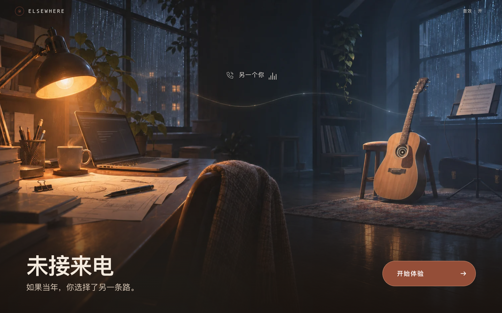

# 〖2026 Qoder 高校创造力大赛〗〖LifeHack 生活娱乐〗《Elsewhere：未接来电》

作品链接：<https://elsewhere-missed-call-gfiycnjh8f0.qoder.zone/>

参赛赛道：LifeHack 生活娱乐

所用 Qoder 账号：ZEH-Denia

参赛形式：【个人参赛 / 团队参赛】

参赛成员：【姓名、学校、专业、年级；团队请列出全体成员及分工】

## 一、自我介绍

我是【姓名】，【学校】【专业】【年级】。作品由团队协作完成：团队共同确定产品方向、剧情取舍和验收标准，并批准后续实现与发布；我的个人分工是【填写真实职责】。【如为团队，请列出全体成员及各自分工。】

## 二、作品是什么

《Elsewhere：未接来电》是一款面向喜欢互动故事的读者、可在浏览器中体验的中文分支叙事作品：接听来自“另一个自己”的电话，在两条人生路线中作出选择，读到不同结局与来信。

## 三、为什么做

我想把“如果当年走了另一条路，会怎样”这个念头变成一次可以亲自参与的短篇体验。作品让读者分别走进稳定与热爱并存的两种生活，通过两次选择看见不同回应和结局；它讲的是虚构的另一种可能，不替读者评判现实人生。

## 四、怎么用

1. 打开上方作品链接，点击“开始体验”。
2. 读完序幕后接听来电，选择身份并进入总机。
3. 选择一条职业线路，点击“继续”推进对白，也可把鼠标移到场景物件的光点上查看短注释。
4. 在两处剧情节点各选一次，观察选择如何影响后续回应与结局。
5. 读完结局和来信后，可进入最终回电，或返回总机体验其他线路。

## 五、怎么用 Qoder 做出来

项目早期，团队确定产品方向、剧情用稿和验收标准，Qoder IDE 从应用工程开始实现首页与前言、首通来电、两次选择和四种结局，并继续完成职业线路、场景、来信、总机和最终回电等功能。团队根据试玩反馈调整剧情、视觉和交互要求；Codex 对 Qoder 阶段的实现进行独立审查并修复验收发现的问题。

2026 年 11 月 21 日起，团队安排 Codex 接手后续实现与验收。Codex 完成了 28 项桌面视觉改进、43 张写实雨夜场景插画、场景推镜与视差、七项桌面体验增强及八处物件热点的呼吸提示，并将剧情测试扩展到 23 项。当前发布版本包含这段由 Codex 完成的源码和视觉改动；不能说当前代码全部由 Qoder IDE 编写。

公开托管与发布通过 Qoder Sites 完成，使用 Qoder 账号 `ZEH-Denia`，保留了原公开网址。Qoder Sites 是托管平台，和 Qoder IDE 的代码开发分开说明。最终构建通过类型检查、23 项剧情测试和生产构建；线上 87 个非 HTML 资源均与发布包的 SHA-256 一致。

发帖时建议再附上 Qoder IDE 的真实开发过程截图和 Qoder Sites 已发布状态截图。请从实际应用截取，不要伪造或改写时间；上传前遮去个人隐私、令牌及无关账号信息。

## 仅供内部的提交前核对（不要粘贴进帖子）

官方赛题说明要求开发与部署均由 Qoder 完成。当前版本包含 Codex 后续实现，发帖前应向赛事运营确认这一分工是否符合要求。此处记录的是实际工具分工，不应为满足规则而删改事实。
