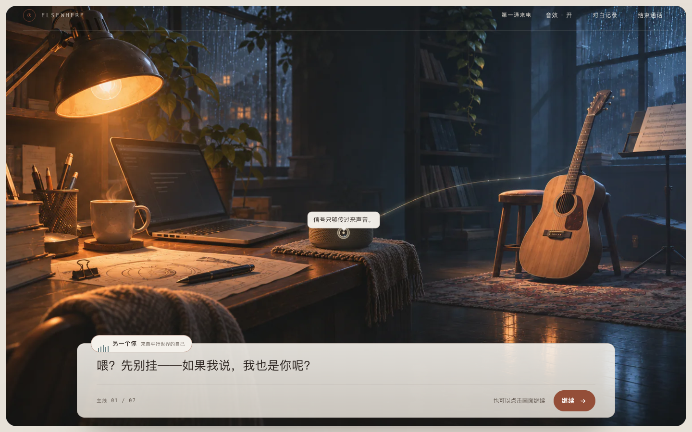

# 〖2026 Qoder 高校创造力大赛〗〖LifeHack 生活娱乐〗《Elsewhere：未接来电》

作品链接：<https://elsewhere-missed-call-gfiycnjh8f0.qoder.zone/>

参赛赛道：LifeHack 生活娱乐

所用 Qoder 账号：ZEH-Denia

参赛形式：【个人参赛 / 团队参赛】

参赛成员：【姓名、学校、专业、年级；团队请列出全体成员及分工】

## 一、自我介绍

我是【姓名】，【学校】【专业】【年级】。我负责提出作品方向、确定剧情与交互取舍，并试玩和审查关键流程。【如为团队，请在此写明每位成员的真实分工。】

## 二、作品是什么

《Elsewhere：未接来电》是一款面向喜欢互动故事的读者、可在浏览器中体验的中文分支叙事作品：接听来自“另一个自己”的电话，在两条人生路线中作出选择，读到不同结局与来信。

## 三、为什么做

我想把“如果当年走了另一条路，会怎样”这个念头变成一次可以亲自参与的短篇体验。作品让读者分别走进稳定与热爱并存的两种生活，通过两次选择看见不同回应和结局；它讲的是虚构的另一种可能，不替读者评判现实人生。

## 四、怎么用

1. 打开上方作品链接，点击“开始体验”。
2. 读完序幕后接听来电，选择身份并进入总机。
3. 选择一条职业线路，点击“继续”推进对白，也可把鼠标移到场景物件的光点上查看短注释。
4. 在两处剧情节点各选一次，观察选择如何影响后续回应与结局。
5. 读完结局和来信后，可进入最终回电，或返回总机体验其他线路。

## 五、怎么用 Qoder 做出来

前期我把剧情用稿、产品方向和验收要求整理成分阶段任务，使用 Qoder IDE 完成了初始工程、剧情交互、场景素材和开发过程验证。随后根据实际试玩结果持续提出修正意见，并对流程、分支和页面进行复核。

**开发工具分工说明：** 团队于 2026 年 11 月 21 日决定由 Codex 承担后续项目实现。当前发布版本包含此后由 Codex 完成的源码与视觉改进；本次静态网站更新由 Qoder Sites 发布。因此，不能将当前全部代码表述为均由 Qoder IDE 编写。建议在正式发帖前向赛事运营确认这类后续协作方式是否符合“开发与部署均由 Qoder 完成”的作品要求。

发帖时建议再附上 Qoder IDE 的真实开发过程截图和 Qoder Sites 已发布状态截图。请从实际应用截取，不要伪造或改写时间；上传前遮去个人隐私、令牌及无关账号信息。
